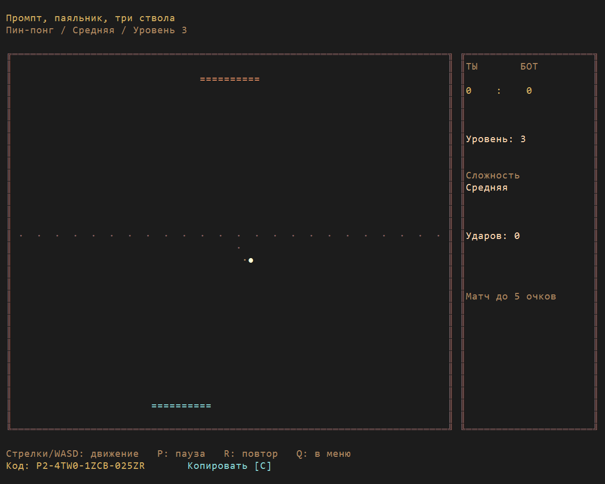
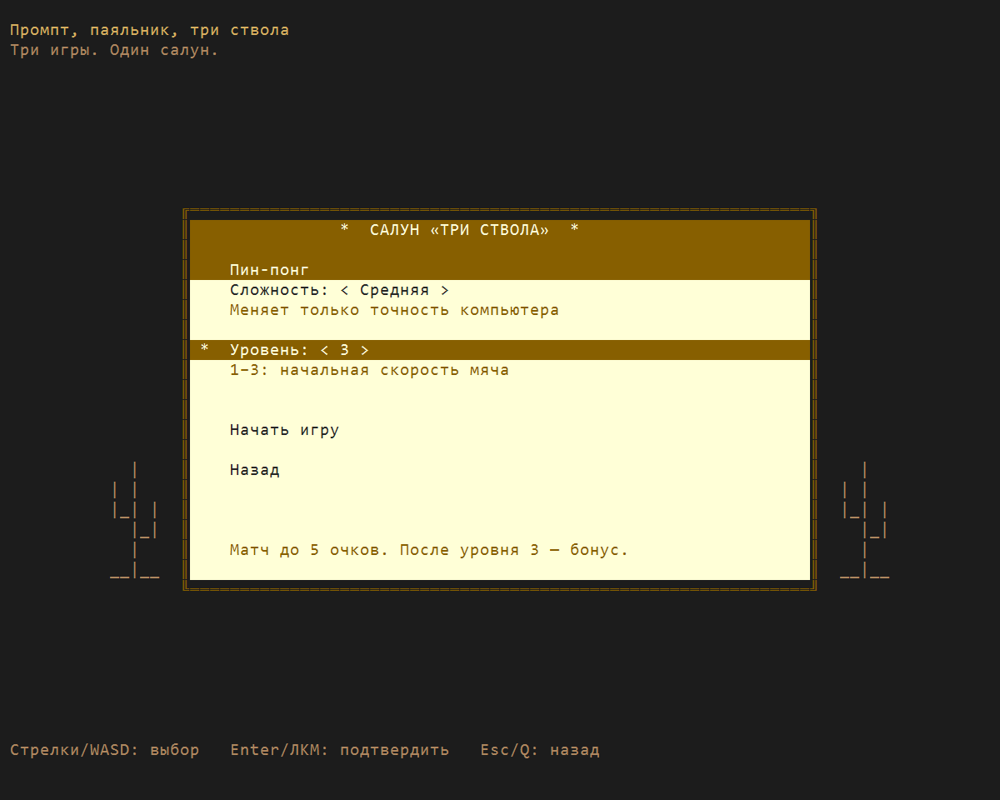

# Проверка экрана и пин-понга — 19 ноября 2026

Проверена прошивка с настоящим пин-понгом; тетрис и сапёр остаются заглушками.
Результаты относятся к локальной Windows-сборке этого изменения. GitHub Actions
первого коммита `47913eb` успешно собрал ESP32 и проверил общий код;
результаты следующего CI будут доступны в PR «Пин-понг и испытания».

## Среда и сборка

Windows: ESP-IDF v5.5.1, ESP32, GCC 14.2.0 (esp-14.2.0_20241119), C++17,
CMake 3.30.2, Ninja 1.12.1, Python 3.12.0. QEMU 9.0.0
(esp_develop_9.0.0_20240606), GDB 16.2_20250324.
Команды: `powershell -ExecutionPolicy Bypass -File tools/build.ps1`, затем
`powershell -ExecutionPolicy Bypass -File tools/test.ps1`.
SHA-256 локального gaming_mps.bin: `e90646af425d41661f56814d309b5ee30a3dbcd70e242374ac0df2d5e232fa6d`.

## Выполненные проверки

- Общий C++ код и модель Pong: GCC, -Wall -Wextra -Werror,
  AddressSanitizer/UBSan (`ASAN_OPTIONS=detect_leaks=0`), без ошибок.
  Проверены отражения и перехват ракеток, очки/конец матча, неизменность после
  окончания, seed=0, повторяемость при разном дроблении времени и отсутствие
  побочных эффектов draw. Все 12 сочетаний уровня и сложности завершают матч
  при тестовом управлении. Это не доказательство баланса для человека.
- Ускорение: пороги 10/15 секунд, предел ×2 на 45-й секунде, сброс после очка/R;
  одинаковые пределы ракеток, зоны двух ботов и точность трёх сложностей.
- Общий контракт: фрагментация ввода, CRLF/Esc, границы мыши, пауза/повтор,
  новый seed, выбор 1–3, переход после победы на третьем в бонусный четвёртый
  и отсутствие пятого. Переход после победы проверяется управляемым двойником.
- Коды: независимые векторы P2 `P2-4SW5-CD0J-0228E` и старого P1
  `P1-041020-R00007-GNHM2B-ZZYZJ4`, round-trip диапазонов, CRC/бит заполнения,
  первый ход сапёра, сохранение выходных настроек при ошибке декодирования.
- Реальный ESP32/QEMU по UART: меню и оставшиеся заглушки, чистые панели,
  выбор уровня, Pong с клавишами/мышью, естественный конец матча,
  повтор/новая партия, P1→P2, повреждённый код, бонус с двумя ракетками,
  копирование кнопкой/C/из паузы, справка и возврат.
- OSC52: произвольная фрагментация с UTF-8, успех/отказ, повреждённый Base64,
  ограничение длины и восстановление потока после превышения лимита.
- Настоящий буфер Windows: код записан и прочитан обратно через WinAPI;
  исходные форматы буфера восстановлены. Нативные события проходят путь
  WriteConsoleInputW → запускатель → UART → прошивка. После проверенных переходов
  все 100×40 символов ReadConsoleOutputCharacterW совпали с кадром прошивки.
  Вход синтетический, физические движения и клики человека не проверялись.
- UTF-8, разбитый по каждому байту, сохраняет русские буквы/рамки без U+FFFD;
  WriteConsoleW корректно выводит правый край в столбце 100.
- GDB останавливается в app_main и выполняет два next с тремя различными PC;
  точные адреса и исходник — в приложенном логе. Предупреждение CP1252/UTF-32
  от GDB не помешало шагам.
- Doxygen 1.18.0: WARN_AS_ERROR=FAIL_ON_WARNINGS, без предупреждений.
  Каждый собственный файл прошивки меньше 2000 строк.

Физический ESP32/JTAG и запуск на втором компьютере не проверялись.

## Подтверждения

- [Завершение сборки](evidence/build.txt).
- [Результаты C++, QEMU и нативной консоли](evidence/checks.txt).
- [Шаги GDB](evidence/gdb-step.txt).

Изображения восстановлены из реальных UART-данных прошивки;
это не скриншоты рабочего стола Windows.

Полные локальные логи и кадры создаются в artifacts/, HTML документация —
в docs/html/. Они исключены из Git вместе со сборками и SDK.
