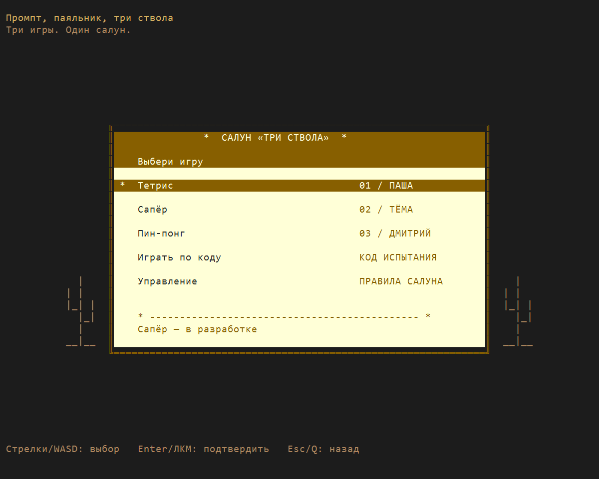
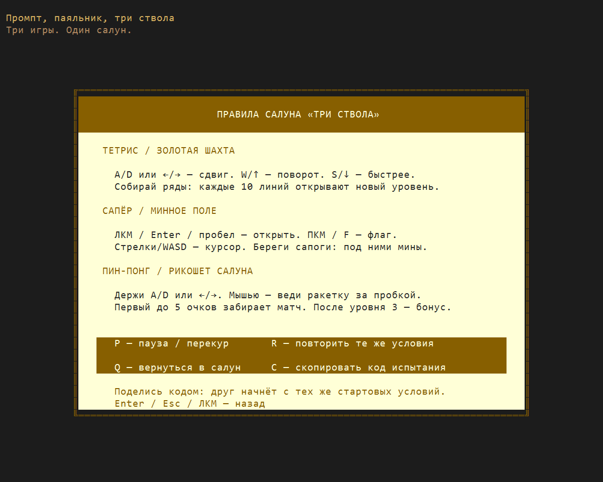
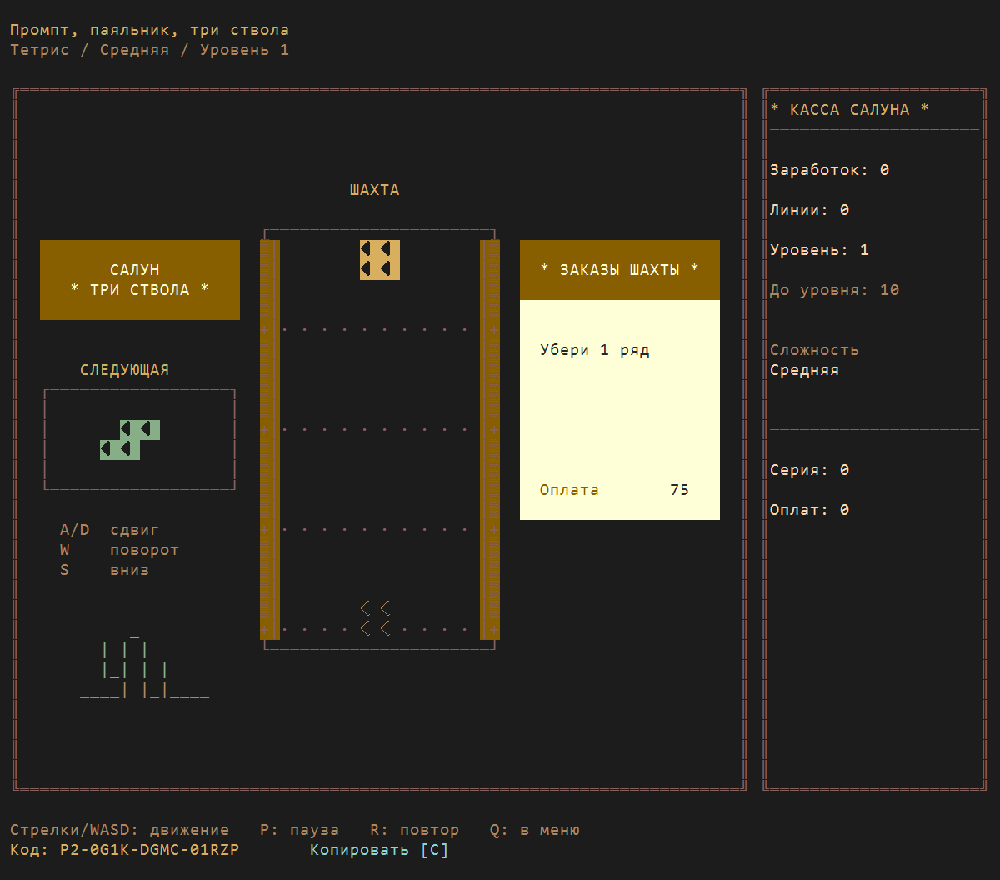
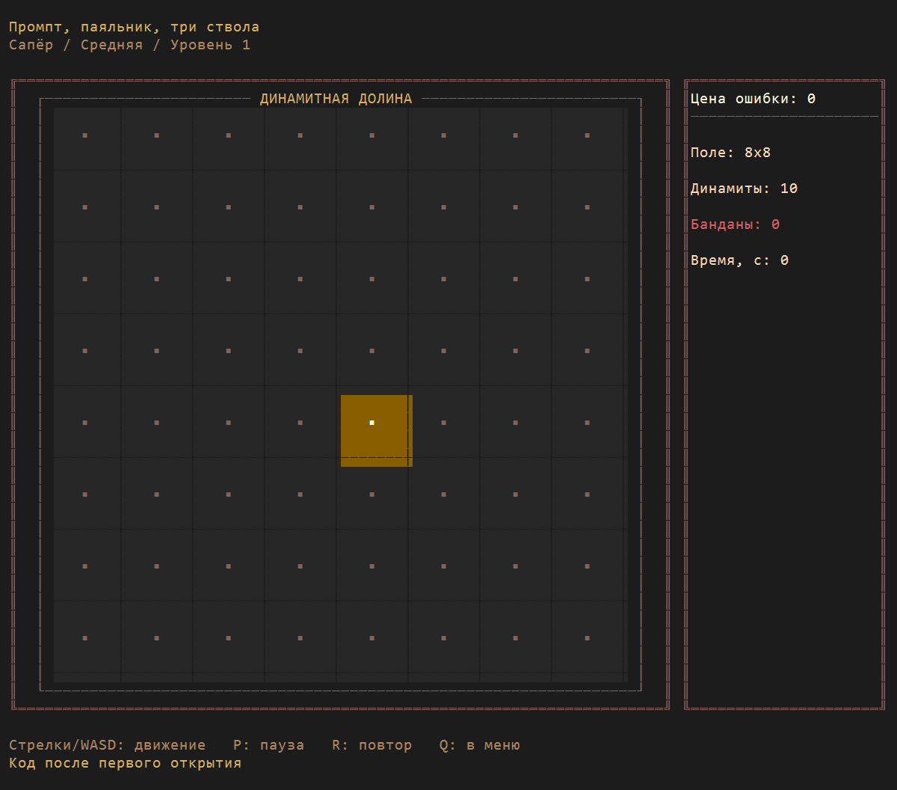
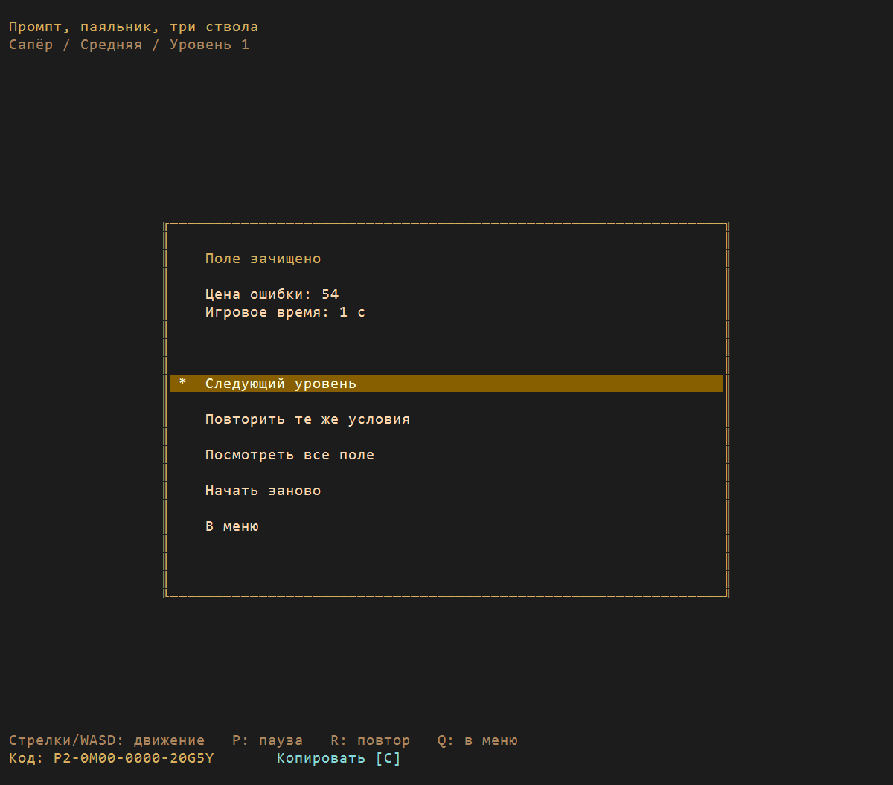
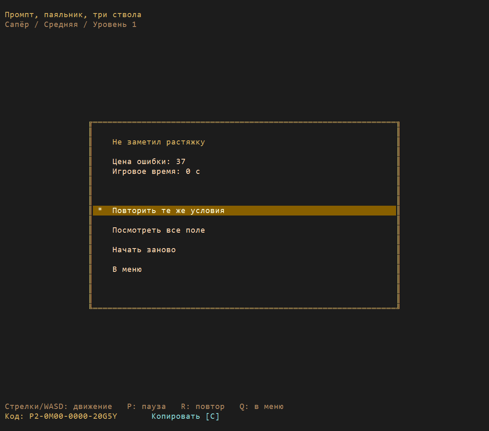
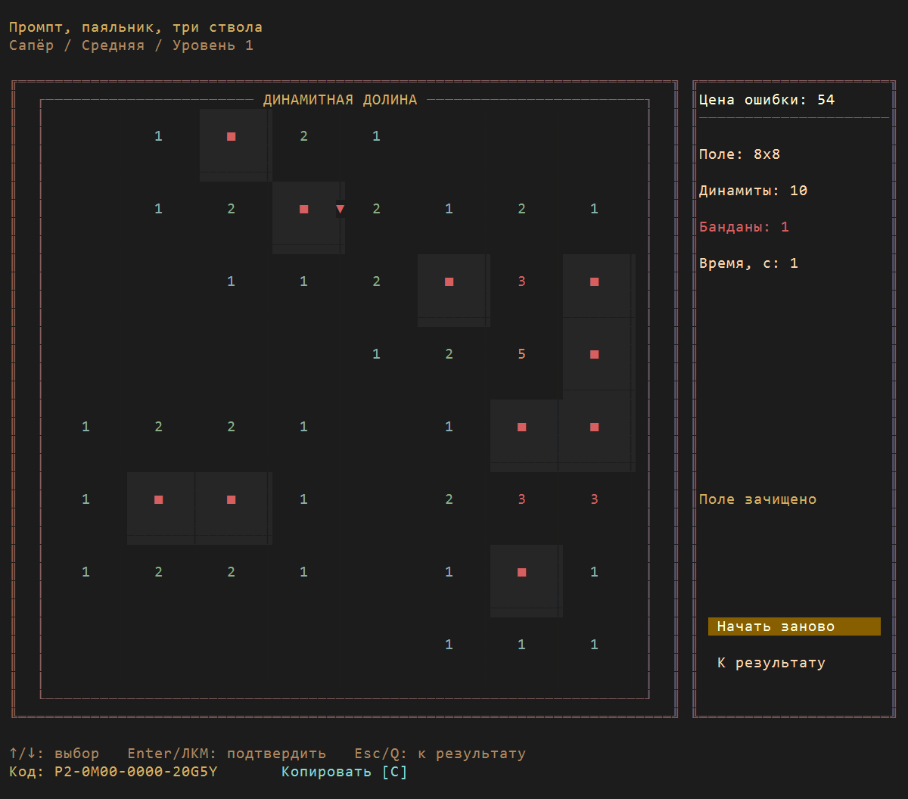
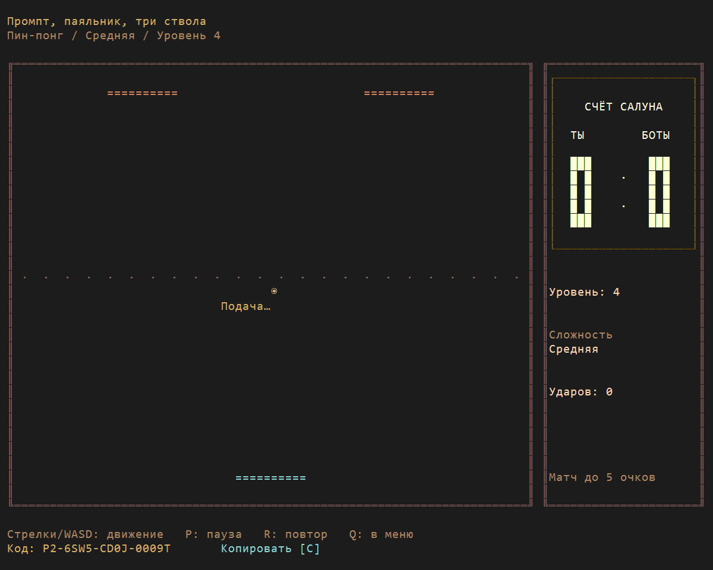

# Проверка финальной версии — 20 ноября 2026

Проверены все три игры и финальное оформление: кружка внутри главного меню,
компактные подписи, «Краткая сводка» без подсказки про вставку кода.
Материалы ниже относятся к этому состоянию исходников. Версию сборки содержит
лог; окончательную ревизию сдачи нужно указать полным хешем main вместе с видео.

## Результаты

| Проверка | Фактический результат |
| --- | --- |
| ESP32 / ESP-IDF 5.5.1 / GCC / CMake | Прошивка собирается, gaming_mps.bin создан |
| Общая оболочка и Pong, C++ ASan/UBSan | Без ошибок; P2, ввод, пауза, повтор, границы и бонус проверены |
| Сапёр, C++ ASan/UBSan | Все 15 профилей, раскрытие, банданы, счёт, победа/поражение и просмотр поля проверены |
| QEMU и GDB | app_main, два next и три разных значения PC |
| Windows | Все 100×44 ячейки консоли совпадают с кадром прошивки; RU/EN, мышь и удержание работают |
| Буфер Windows | C, ↑ и Ctrl+V проверены; исходные форматы буфера после теста восстановлены |
| USB-UART адаптер | Передача и частичные записи проверены; pyserial loopback успешен |
| Тетрис в QEMU | Все сложности, 10 очищенных линий, уровень 2, заказы, проигрыш и повтор |
| Темп тетриса | Замерены 1497 / 950 / 500 мс; средняя на уровне 2 — 854 мс; ожидаемые 1500 / 950 / 500 / 863 мс с допуском кадра |
| Сапёр в QEMU | P2, раскрытие соседей, оба исхода, просмотр всего поля, новая партия и разные коды |
| Doxygen 1.18.0 | Генерация HTML без предупреждений, WARN_AS_ERROR=FAIL_ON_WARNINGS |
| Ограничение файлов | Самый большой собственный файл прошивки — common/menu.cpp, 491 строк; лимит 2000 |
| Gitignore | build, artifacts, SDK-окружение и сгенерированный HTML не входят в Git |

Pong: после победы на уровне 3 бонус предлагается при всех трёх сложностях;
после уровня 2 бонуса нет. Ускорение проверено на порогах 10/15 секунд,
сброс после очка/R и предел ×2. Показ двух ковбоев по коду проверен в QEMU.

Независимую сборку исходников и CTest на Linux, а также сборку прошивки в
контейнере ESP-IDF выполняет [GitHub Actions](https://github.com/disunchik/gaming_mps/actions).
Ссылку на успешный запуск для финального коммита нужно приложить к сдаче.

Физический ESP32 и физическое соединение JTAG/SWD здесь не проверялись.
Программная сессия GDB в QEMU не подменяет аппаратное подтверждение.
Изображения ниже восстановлены из реальных UART-данных прошивки;
они не являются фотографиями платы или скриншотами рабочего стола.

## Повтор проверки

Из корня проекта в Windows:

```powershell
powershell -ExecutionPolicy Bypass -File tools/build.ps1
powershell -ExecutionPolicy Bypass -File tools/test.ps1
powershell -ExecutionPolicy Bypass -File tools/docs.ps1
```

Для C++ на ПК: `cmake -S tests -B build-host`, `cmake --build build-host`,
`ctest --test-dir build-host --output-on-failure`.
Фактические результаты доступны в [логе сборки](evidence/build.txt),
[логе проверок](evidence/checks.txt) и [пошаговой сессии GDB](evidence/gdb-step.txt).

## Кадры финальной прошивки



















Сценарий ручной демонстрации и список материалов: [DEMO.md](DEMO.md).


## Дополнение: VS Code

Configure-VSCode.cmd и F5 настроены для установленного Microsoft C/C++.
Фактическая проверка DAP-адаптера подтверждает остановку в app_main, два next,
пользовательскую точку останова на main.cpp:37, стек и scopes. Архитектура
подключённого GDB — Xtensa. [Лог проверки адаптера](evidence/vscode-debug.txt).
Это проверка протокола отладчика; видео интерфейса VS Code ещё не записано.

Порты VS Code 5558/3334 и отдельные образы QEMU позволяют оставить другую
ручную сессию работающей. Обычный запуск по-прежнему использует 5555/3333.
