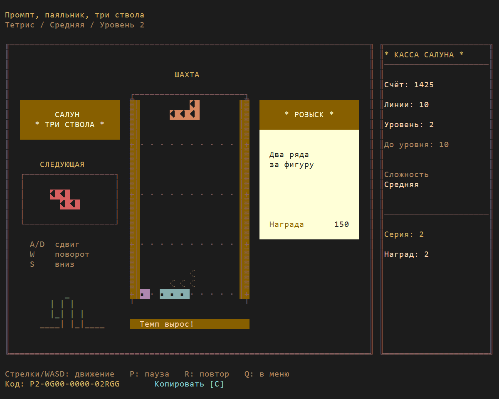
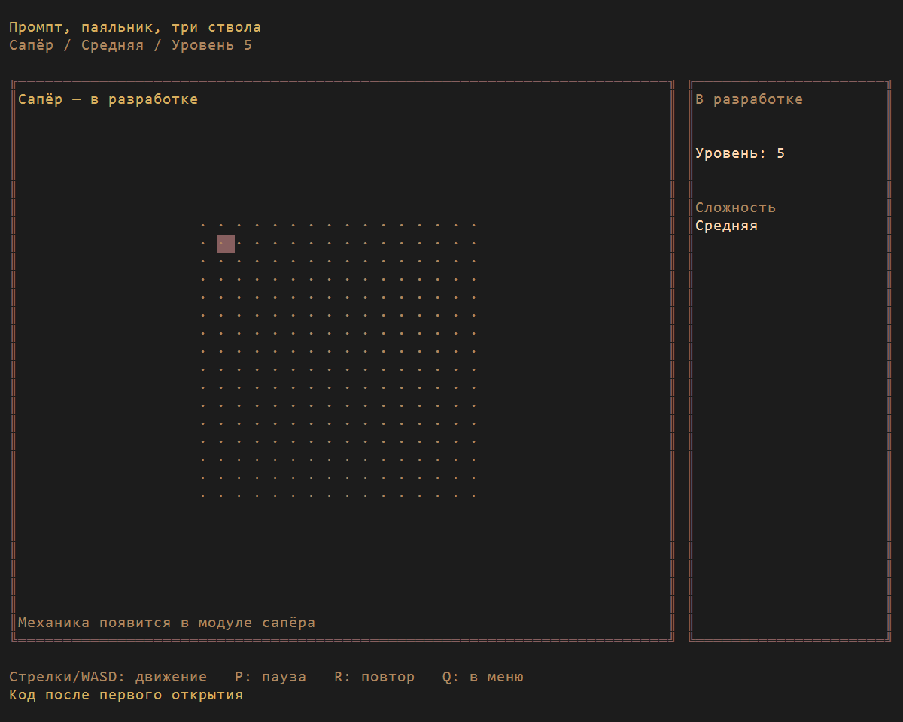

# Проверка тетриса и пин-понга — 19 ноября 2026

Проверена общая прошивка с настоящими тетрисом и пин-понгом; сапёр остаётся
заглушкой. Тетрис объединён из [PR №1](https://github.com/disunchik/gaming_mps/pull/1)
с сохранением коммитов Паши. Сборка и C++ проверки PR прошли в GitHub Actions.
Описанные ниже Windows/QEMU-проверки выполнены локально после обновления общих
тестов и подписей меню; статус CI этих изменений доступен в соответствующем PR.

## Среда и сборка

Windows: ESP-IDF v5.5.1, ESP32, GCC 14.2.0 (esp-14.2.0_20241119), C++17,
CMake 3.30.2, Ninja 1.12.1, Python 3.12.0. QEMU 9.0.0
(esp_develop_9.0.0_20240606), GDB 16.2_20250324.
Команды: `powershell -ExecutionPolicy Bypass -File tools/build.ps1`, затем
`powershell -ExecutionPolicy Bypass -File tools/test.ps1`.
SHA-256 локального gaming_mps.bin: `7b3a797c3f75ebf016edee4dc85aa6c092058d902d5709fadd24a6c46a2e6cae`.

## Выполненные проверки

- Общий C++ код и модель Pong: GCC, -Wall -Wextra -Werror,
  AddressSanitizer/UBSan (`ASAN_OPTIONS=detect_leaks=0`), без ошибок.
  Проверены отражения и перехват ракеток, очки/конец матча, неизменность после
  окончания, seed=0, повторяемость при разном дроблении времени и отсутствие
  побочных эффектов draw. Все 12 сочетаний уровня и сложности завершают матч
  при тестовом управлении. Это не доказательство баланса для человека.
- Тетрис: семь фигур/мешок с seed=0, столкновения и повороты, очистка 1–4
  строк, рост уровня на границах 9/19 линий, контур/предпросмотр, задания/награды,
  серии, деление времени, поражение и повтор. Проверки Паши подключены в CTest
  как `tetris_rules` и отдельно прошли ASan/UBSan.
- Тетрис в реальном QEMU: все три сложности, движение, пауза/повтор, поражение,
  первая награда, золотая жила и переход на уровень 2. Старый код
  `P1-040020-800000-000003-ZZYV67` и новый `P2-0G00-0000-02RGG` проходят
  одинаковую последовательность фигур и действий; повтор выдаёт P2.
- Ускорение: пороги 10/15 секунд, предел ×2 на 45-й секунде, сброс после очка/R;
  одинаковые пределы ракеток, зоны двух ботов и точность трёх сложностей.
- Общий контракт: фрагментация ввода, CRLF/Esc, границы мыши, пауза/повтор,
  новый seed, выбор 1–3, переход после победы на третьем в бонусный четвёртый
  и отсутствие пятого. Переход после победы проверяется управляемым двойником.
- Коды: независимые векторы P2 `P2-4SW5-CD0J-0228E` и старого P1
  `P1-041020-R00007-GNHM2B-ZZYZJ4`, round-trip диапазонов, CRC/бит заполнения,
  первый ход сапёра, сохранение выходных настроек при ошибке декодирования.
- Реальный ESP32/QEMU по UART: меню, настоящий тетрис и заглушка сапёра, чистые панели,
  выбор уровня, Pong с клавишами/мышью, естественный конец матча,
  повтор/новая партия, P1→P2, повреждённый код, бонус с двумя ракетками,
  копирование кнопкой/C/из паузы, справка и возврат.
- OSC52: произвольная фрагментация с UTF-8, успех/отказ, повреждённый Base64,
  ограничение длины и восстановление потока после превышения лимита.
- Настоящий буфер Windows: код записан и прочитан обратно через WinAPI;
  исходные форматы буфера восстановлены. Нативные события проходят путь
  WriteConsoleInputW → запускатель → UART → прошивка. После проверенных переходов
  все 100×40 символов ReadConsoleOutputCharacterW совпали с кадром прошивки.
  Проверены экраны обеих игр. Вход синтетический, физические движения и клики
  человека не проверялись. При первом прогоне OpenClipboard отказал при чтении
  после записи; тест теперь повторяет открытие до 2 секунд, не очищая буфер
  до сохранения исходных форматов. Повторная проверка записи/чтения успешна.
- UTF-8, разбитый по каждому байту, сохраняет русские буквы/рамки без U+FFFD;
  WriteConsoleW корректно выводит правый край в столбце 100.
- GDB останавливается в app_main и выполняет два next с тремя различными PC;
  точные адреса и исходник — в приложенном логе. Предупреждение CP1252/UTF-32
  от GDB не помешало шагам.
- Doxygen 1.18.0: WARN_AS_ERROR=FAIL_ON_WARNINGS, без предупреждений.
  Каждый собственный файл прошивки меньше 2000 строк.

Физический ESP32/JTAG и запуск на втором компьютере не проверялись.

## Подтверждения

- [Завершение сборки](evidence/build.txt).
- [Результаты C++, QEMU и нативной консоли](evidence/checks.txt).
- [Шаги GDB](evidence/gdb-step.txt).

Изображения восстановлены из реальных UART-данных прошивки;
это не скриншоты рабочего стола Windows.

Полные локальные логи и кадры создаются в artifacts/, HTML документация —
в docs/html/. Они исключены из Git вместе со сборками и SDK.
